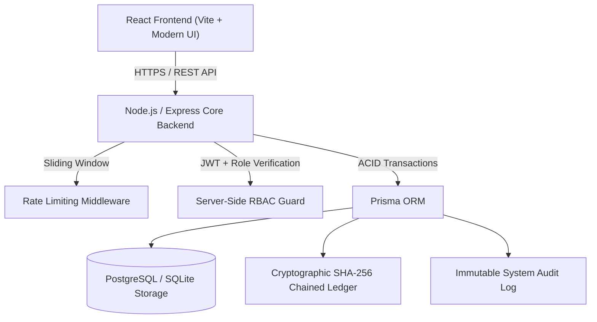

# BalanceVault — Money Movement with a Ledger You Can Prove

A high-integrity account management and financial movement platform featuring server-enforced Role-Based Access Control (RBAC), user onboarding/KYC workflows, atomic double-entry money movements, and a cryptographically verifiable SHA-256 chained audit ledger.

Built for the **Snovasys Fresher Hiring Challenge 2026 — VVIT**.

---

## 🏛️ System Architecture



### Key Pillars

1. **A Ledger You Can Prove (Zero-Trust Cryptographic Chain)**:
   - Every financial transaction produces dual ledger entries (DEBIT and CREDIT) implementing double-entry accounting.
   - Each entry links to the previous entry via SHA-256 cryptographic hash pointers:
     $$\text{Hash}_n = \text{SHA256}(\text{Entry\#} \parallel \text{PrevHash} \parallel \text{TxID} \parallel \text{AccountID} \parallel \text{Type} \parallel \text{Amount} \parallel \text{BalanceAfter} \parallel \text{Timestamp})$$
   - An on-demand mathematical verification engine (`/api/audit/ledger/verify`) scans the entire chain from Genesis block (`0000...0000`) to the latest tip, recalculates every hash, verifies pointer continuity, and confirms that net double-entry debits equal credits. Any unauthorized database modification immediately flags the exact corrupted entry.

2. **Server-Enforced Role-Based Access Control (RBAC)**:
   - `ADMIN`: Full authority. Approves/rejects onboarding KYC, promotes user roles, reviews system liquidity, and audits all security logs.
   - `OPERATOR`: Operations officer. Verifies ledger integrity, inspects user registrations, and audits operational logs.
   - `ACCOUNT_HOLDER`: User account. Views vault balance, executes deposits and transfers, and inspects individual cryptographic transaction receipts.
   - Guarded at the middleware layer (`requireRole`, `requireApprovedAccount`).

3. **First-Administrator Bootstrap & Lockdown**:
   - Solves the bootstrap dilemma: when the application is freshly deployed with 0 admins, a dedicated endpoint (`/api/auth/bootstrap-admin`) allows the deployment operator to initialize the initial root administrator.
   - Once the first administrator is created, the bootstrap endpoint is **permanently locked down** against unauthorized calls, requiring a secret master key (`BOOTSTRAP_SECRET`) configured via environment variables.

4. **Health & Readiness Probes**:
   - `/api/health`: Provides uptime, memory metrics, and service status.
   - `/api/ready`: Tests database connectivity and ledger table accessibility.

---

## 🚀 Quick Start Guide

### Prerequisites
- Node.js (v18+ or v20+)
- npm (v9+)

### 1. Installation
In the project root, install all dependencies across the monorepo workspaces:
```bash
npm install
```

### 2. Database Migration & Client Generation
Initialize the database and generate the Prisma Client:
```bash
# Generate Prisma Client
npm run db:generate

# Apply migrations / push schema
npm run db:migrate

# Seed demo accounts and genesis ledger
npm run db:seed
```

### 3. Run Development Server
Start both the Express backend (`http://localhost:5000`) and the React frontend (`http://localhost:5173`) concurrently:
```bash
npm run dev
```

### 4. Run Automated Tests
Execute the verification suite covering RBAC, ledger tampering detection, atomic transfers, and bootstrap security:
```bash
npm test
```

---

## 🔑 Default Seeded Demo Credentials

| Role | Email | Password | Initial Balance | Account Number |
| :--- | :--- | :--- | :--- | :--- |
| **👑 Admin** | `admin@balancevault.com` | `Admin@123456` | ₹1,000,000.00 | `BV-TREASURY-01` |
| **⚙️ Operator** | `operator@balancevault.com` | `Admin@123456` | — | — |
| **👤 Alice (User)** | `alice@example.com` | `User@123456` | ₹50,000.00 | `BV-ACC-10020031` |
| **👤 Bob (User)** | `bob@example.com` | `User@123456` | ₹25,000.00 | `BV-ACC-10020032` |

> *Tip: The web interface includes one-click demo login buttons to instantly switch between Admin, Operator, and Account Holder views.*

---

## 📡 API Reference

### Health & Monitoring
- `GET /api/health` — Service liveness and memory probe.
- `GET /api/ready` — Database and storage readiness check.

### Authentication & Bootstrap
- `GET /api/auth/bootstrap-status` — Checks if initial admin setup is required.
- `POST /api/auth/bootstrap-admin` — Secure one-time root administrator creation.
- `POST /api/auth/register` — Registers new account holder with pending KYC status.
- `POST /api/auth/login` — Authenticates user, issues JWT token.
- `GET /api/auth/me` — Fetches current user profile and account details.

### Financial Transactions & Money Movement
- `POST /api/transactions/deposit` — Deposits funds into account and creates cryptographic credit entry.
- `POST /api/transactions/transfer` — Executes atomic transfer between accounts with debit/credit ledger creation.
- `GET /api/transactions/history` — Lists transaction history with cryptographic hashes.

### Verifiable Ledger & Audit Logs
- `GET /api/audit/ledger/verify` — Mathematical verification of entire SHA-256 chain and balance reconciliation.
- `GET /api/audit/ledger/entries` — Browse chronological ledger blocks.
- `GET /api/audit/logs` — Query immutable audit events (RBAC protected: Admin/Operator).

### Administration
- `GET /api/admin/stats` — System liquidity, total users, total entries.
- `GET /api/admin/users` — User management and onboarding overview.
- `PATCH /api/admin/users/:userId/status` — Approve or reject user onboarding.
- `PATCH /api/admin/users/:userId/role` — Update user role (Admin only).

